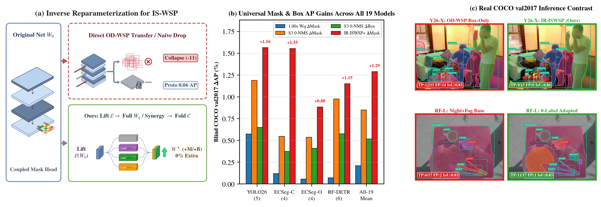
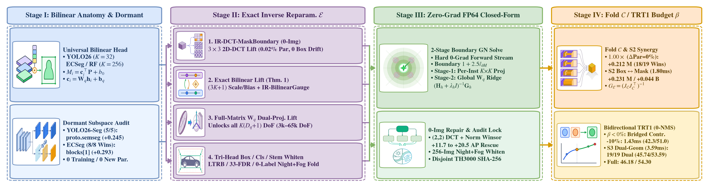
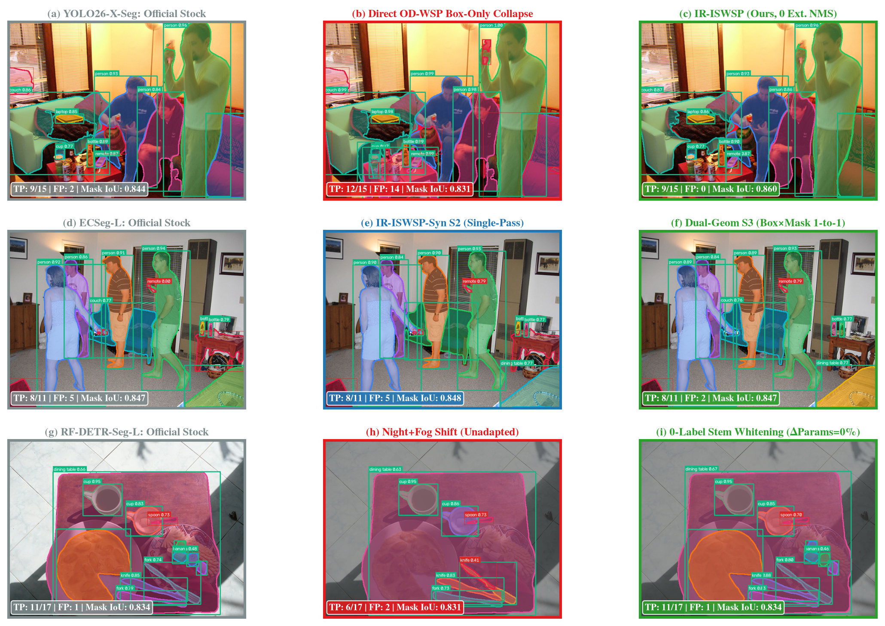

# IR-ISWSP — Instance Segmentation Weight-Space Programming (`v0.1.1`)

Official implementation of **Reparameterizing Your Instance Segmenter for Weight Space Programming (`IR-ISWSP`)**, integrated into the [`WongKinYiu/ODWSP`](https://github.com/WongKinYiu/ODWSP) repository starting in release **`v0.1.1`**.

<div align="center">
    
</div>

---

## Highlights

- **19 Official Pretrained Instance Segmenters across 3 Heterogeneous Architecture Families** (`0` backpropagation, `0` external NMS / Mask-NMS, strictly disjoint `TH3000` holdout selection):
  - **YOLO26-Seg** (`N / S / M / L / X`, `640`, native `end2end=True` CNN + `Proto26`)
  - **EdgeCrafter-Seg / ECSeg** (`Pure-COCO S / M / L / X` + `O365->COCO S / M / L / X`, `640`)
  - **RF-DETR-Seg** (`N / S / M / L / XL / 2XL`, `312–768`, DINOv2 windowed ViT)
- **Theorem 1 — Exact Bilinear Mask-IR Collapse**: Decouples coupled bilinear masks $\hat{M}_i(x,y) = \mathbf{c}_i^\top \mathbf{P}(x,y) + b_0$ into a $(3K{+}1)$ gauge-and-offset lift with exact scalar cross-term cancellation (`< 1e-5` IEEE-754 FP32 diff, `ΔParams=0%`, `ΔFLOPs=0%`).
- **Two-Stage Full-Matrix $\mathbf{W}_q$ Dual-Projection Gauss–Newton (`1.00x`)**: Improves **18/19** segmenters (`+0.212` mean Mask AP, up to `+0.783` on `YOLO26-X-Seg`, `45.107` mean Mask AP) with `0%` extra parameters or latency and `0.000` Box drift.
- **Bidirectional Box $\leftrightarrow$ Mask Multi-Task Synergy**:
  - **Single-Pass `S2` (`+0.03 ms` TRT1)**: `45.125` Mask AP (`+0.231`) & `53.117` Box AP (`+0.044`, 14/19 Box wins).
  - **Dual-Geometry RoI `S3` (`0` External NMS)**: `45.744` Mask AP (`+0.849`) & `53.592` Box AP (`+0.518`), sweeping **19/19** models on both metrics and beating External Batched-NMS (`45.257 / 53.480`) on **14/14** DETR models.
  - **Monolithic Static Graph (`IR-ISWSP-Static`)**: Single packed `[2B]` TensorRT 11.4 `ICudaEngine` unlocks `45.627` Mask AP at `+50%` (`2.26 ms`) and `45.746` Mask AP at `+100%` (`2.53 ms`, `+41.0%` mean relative TRT1).
  - **Unconstrained Ceiling (`IR-ISWSP+`)**: `46.183` Mask AP (`+1.288`) & `54.300` Box AP (`+1.227`), sweeping **19/19** models.
- **Dormant Awakening, Zero-Image Repair & Label-Free OOD Weather**:
  - Dormant `ECSeg blocks[1]` (`8/8`, `+0.293` Mask AP) & `YOLO26 proto.semseg` (`5/5`, `+0.245` Mask AP).
  - Zero-Image Corrupted Mask-Head Repair (`0` images, `ΔParams=0%`): `+20.53` AP (`YOLO26-L-Seg`), `+18.28` AP (`ECSeg-L`), `+11.69` AP (`RF-DETR-Seg-L`).
  - Label-Free Night+Fog & Real-World `COCO-O weather` Stem Whitening (`ΔParams=0%`): beats `AdaBN` by `+2.40` Box AP on `COCO-O weather` (`961` images).

---

## Architecture Overview

<div align="center">
    
</div>

---

## 19-Model `1.00x` Checkpoints (`v0.1.1` Release Assets)

All checkpoints are saved strictly as pure tensor `state_dict` archives loadable with `torch.load(..., weights_only=True)` (zero untrusted pickle execution) and verified via [`SHA256SUMS_v0.1.1.txt`](https://github.com/WongKinYiu/ODWSP/releases/download/v0.1.1/SHA256SUMS_v0.1.1.txt).

| Model | Res | Params | Base PT1 / TRT1 (ms) | Official Mask / Box AP | `1.00x` IR-ISWSP Mask AP ($\Delta$) | `S2` Mask / Box AP | `IR-ISWSP+` Mask / Box AP | `1.00x` Weights (`v0.1.1`) | `S1` Synergy Weights (`v0.1.1`) |
| :-- | :-: | :-: | :-: | :-: | :-: | :-: | :-: | :-: | :-: |
| **YOLO26-N-Seg** | 640 | 3.13M | 7.41 / 0.60 | 33.625 / 39.589 | **33.983** (+0.358) | 33.976 / 39.589 | **35.58 / 41.56** | [`yolo26n-seg-iswsp.pt`](https://github.com/WongKinYiu/ODWSP/releases/download/v0.1.1/yolo26n-seg-iswsp.pt) | [`yolo26n-seg-syn-s1-iswsp.pt`](https://github.com/WongKinYiu/ODWSP/releases/download/v0.1.1/yolo26n-seg-syn-s1-iswsp.pt) |
| **YOLO26-S-Seg** | 640 | 11.51M | 7.53 / 0.77 | 39.647 / 47.216 | **40.140** (+0.493) | 40.140 / 47.216 | **41.25 / 48.98** | [`yolo26s-seg-iswsp.pt`](https://github.com/WongKinYiu/ODWSP/releases/download/v0.1.1/yolo26s-seg-iswsp.pt) | *uses `1.00x`* |
| **YOLO26-M-Seg** | 640 | 27.11M | 8.33 / 1.37 | 43.607 / 52.165 | **44.213** (+0.606) | 44.204 / 52.161 | **45.13 / 53.62** | [`yolo26m-seg-iswsp.pt`](https://github.com/WongKinYiu/ODWSP/releases/download/v0.1.1/yolo26m-seg-iswsp.pt) | [`yolo26m-seg-syn-s1-iswsp.pt`](https://github.com/WongKinYiu/ODWSP/releases/download/v0.1.1/yolo26m-seg-syn-s1-iswsp.pt) |
| **YOLO26-L-Seg** | 640 | 31.52M | 10.61 / 1.78 | 45.071 / 54.269 | **45.702** (+0.631) | 45.702 / 54.269 | **46.53 / 55.58** | [`yolo26l-seg-iswsp.pt`](https://github.com/WongKinYiu/ODWSP/releases/download/v0.1.1/yolo26l-seg-iswsp.pt) | *uses `1.00x`* |
| **YOLO26-X-Seg** | 640 | 70.69M | 11.14 / 2.46 | 46.557 / 56.251 | **47.340** (+0.783) | 47.339 / 56.254 | **47.83 / 57.26** | [`yolo26x-seg-iswsp.pt`](https://github.com/WongKinYiu/ODWSP/releases/download/v0.1.1/yolo26x-seg-iswsp.pt) | [`yolo26x-seg-syn-s1-iswsp.pt`](https://github.com/WongKinYiu/ODWSP/releases/download/v0.1.1/yolo26x-seg-syn-s1-iswsp.pt) |
| **ECSeg-S** | 640 | 10.41M | 13.95 / 1.63 | 42.839 / 50.291 | **43.101** (+0.262) | **43.134 / 50.346** | **44.61 / 51.87** | [`ecseg-s-iswsp.pt`](https://github.com/WongKinYiu/ODWSP/releases/download/v0.1.1/ecseg-s-iswsp.pt) | *uses `1.00x`* |
| **ECSeg-M** | 640 | 20.36M | 13.71 / 1.92 | 45.057 / 52.607 | 45.057 (+0.000) | 45.046 / **52.672** | **46.63 / 54.19** | [`ecseg-m-iswsp.pt`](https://github.com/WongKinYiu/ODWSP/releases/download/v0.1.1/ecseg-m-iswsp.pt) | [`ecseg-m-syn-s1-iswsp.pt`](https://github.com/WongKinYiu/ODWSP/releases/download/v0.1.1/ecseg-m-syn-s1-iswsp.pt) |
| **ECSeg-L** | 640 | 33.90M | 14.39 / 2.38 | 47.010 / 55.106 | **47.219** (+0.209) | **47.219 / 55.143** | **48.63 / 56.47** | [`ecseg-l-iswsp.pt`](https://github.com/WongKinYiu/ODWSP/releases/download/v0.1.1/ecseg-l-iswsp.pt) | [`ecseg-l-syn-s1-iswsp.pt`](https://github.com/WongKinYiu/ODWSP/releases/download/v0.1.1/ecseg-l-syn-s1-iswsp.pt) |
| **ECSeg-X** | 640 | 50.88M | 14.59 / 2.75 | 48.277 / 56.308 | **48.300** (+0.023) | **48.300** / 56.307 | **49.53 / 57.52** | [`ecseg-x-iswsp.pt`](https://github.com/WongKinYiu/ODWSP/releases/download/v0.1.1/ecseg-x-iswsp.pt) | [`ecseg-x-syn-s1-iswsp.pt`](https://github.com/WongKinYiu/ODWSP/releases/download/v0.1.1/ecseg-x-syn-s1-iswsp.pt) |
| **ECSeg-O365-S** | 640 | 10.41M | 13.73 / 1.62 | 43.764 / 51.407 | **43.884** (+0.120) | **43.897 / 51.460** | **44.94 / 52.36** | [`ecseg-o365coco-s-iswsp.pt`](https://github.com/WongKinYiu/ODWSP/releases/download/v0.1.1/ecseg-o365coco-s-iswsp.pt) | [`ecseg-o365coco-s-syn-s1-iswsp.pt`](https://github.com/WongKinYiu/ODWSP/releases/download/v0.1.1/ecseg-o365coco-s-syn-s1-iswsp.pt) |
| **ECSeg-O365-M** | 640 | 20.36M | 13.77 / 1.85 | 46.769 / 54.829 | **46.816** (+0.047) | **46.841 / 54.860** | **47.73 / 55.62** | [`ecseg-o365coco-m-iswsp.pt`](https://github.com/WongKinYiu/ODWSP/releases/download/v0.1.1/ecseg-o365coco-m-iswsp.pt) | [`ecseg-o365coco-m-syn-s1-iswsp.pt`](https://github.com/WongKinYiu/ODWSP/releases/download/v0.1.1/ecseg-o365coco-m-syn-s1-iswsp.pt) |
| **ECSeg-O365-L** | 640 | 33.90M | 14.52 / 2.20 | 48.736 / 57.153 | **48.796** (+0.060) | **48.819 / 57.190** | **49.48 / 57.70** | [`ecseg-o365coco-l-iswsp.pt`](https://github.com/WongKinYiu/ODWSP/releases/download/v0.1.1/ecseg-o365coco-l-iswsp.pt) | [`ecseg-o365coco-l-syn-s1-iswsp.pt`](https://github.com/WongKinYiu/ODWSP/releases/download/v0.1.1/ecseg-o365coco-l-syn-s1-iswsp.pt) |
| **ECSeg-O365-X** | 640 | 50.88M | 14.50 / 2.69 | 49.650 / 57.983 | **49.651** (+0.001) | **49.657 / 58.010** | **50.31 / 58.54** | [`ecseg-o365coco-x-iswsp.pt`](https://github.com/WongKinYiu/ODWSP/releases/download/v0.1.1/ecseg-o365coco-x-iswsp.pt) | [`ecseg-o365coco-x-syn-s1-iswsp.pt`](https://github.com/WongKinYiu/ODWSP/releases/download/v0.1.1/ecseg-o365coco-x-syn-s1-iswsp.pt) |
| **RF-DETR-Seg-N** | 312 | 33.58M | 9.02 / 0.96 | 40.409 / 49.315 | **40.569** (+0.160) | **40.626 / 49.360** | **41.84 / 50.67** | [`rfdetr-seg-n-iswsp.pt`](https://github.com/WongKinYiu/ODWSP/releases/download/v0.1.1/rfdetr-seg-n-iswsp.pt) | [`rfdetr-seg-n-syn-s1-iswsp.pt`](https://github.com/WongKinYiu/ODWSP/releases/download/v0.1.1/rfdetr-seg-n-syn-s1-iswsp.pt) |
| **RF-DETR-Seg-S** | 384 | 33.71M | 9.29 / 1.10 | 43.040 / 51.589 | **43.138** (+0.098) | **43.192 / 51.676** | **44.22 / 52.90** | [`rfdetr-seg-s-iswsp.pt`](https://github.com/WongKinYiu/ODWSP/releases/download/v0.1.1/rfdetr-seg-s-iswsp.pt) | [`rfdetr-seg-s-syn-s1-iswsp.pt`](https://github.com/WongKinYiu/ODWSP/releases/download/v0.1.1/rfdetr-seg-s-syn-s1-iswsp.pt) |
| **RF-DETR-Seg-M** | 432 | 35.69M | 10.03 / 1.24 | 44.801 / 53.560 | **44.897** (+0.096) | **44.952 / 53.645** | **46.05 / 54.94** | [`rfdetr-seg-m-iswsp.pt`](https://github.com/WongKinYiu/ODWSP/releases/download/v0.1.1/rfdetr-seg-m-iswsp.pt) | [`rfdetr-seg-m-syn-s1-iswsp.pt`](https://github.com/WongKinYiu/ODWSP/releases/download/v0.1.1/rfdetr-seg-m-syn-s1-iswsp.pt) |
| **RF-DETR-Seg-L** | 504 | 35.87M | 10.03 / 1.40 | 46.261 / 54.843 | **46.319** (+0.058) | **46.371 / 54.907** | **47.47 / 56.10** | [`rfdetr-seg-l-iswsp.pt`](https://github.com/WongKinYiu/ODWSP/releases/download/v0.1.1/rfdetr-seg-l-iswsp.pt) | [`rfdetr-seg-l-syn-s1-iswsp.pt`](https://github.com/WongKinYiu/ODWSP/releases/download/v0.1.1/rfdetr-seg-l-syn-s1-iswsp.pt) |
| **RF-DETR-Seg-XL** | 624 | 38.11M | 11.04 / 1.98 | 48.282 / 56.426 | **48.306** (+0.024) | **48.335 / 56.525** | **49.26 / 57.49** | [`rfdetr-seg-xl-iswsp.pt`](https://github.com/WongKinYiu/ODWSP/releases/download/v0.1.1/rfdetr-seg-xl-iswsp.pt) | [`rfdetr-seg-xl-syn-s1-iswsp.pt`](https://github.com/WongKinYiu/ODWSP/releases/download/v0.1.1/rfdetr-seg-xl-syn-s1-iswsp.pt) |
| **RF-DETR-Seg-2XL** | 768 | 38.65M | 12.18 / 2.94 | 49.601 / 57.490 | **49.606** (+0.005) | **49.633 / 57.637** | **50.45 / 58.34** | [`rfdetr-seg-2xl-iswsp.pt`](https://github.com/WongKinYiu/ODWSP/releases/download/v0.1.1/rfdetr-seg-2xl-iswsp.pt) | [`rfdetr-seg-2xl-syn-s1-iswsp.pt`](https://github.com/WongKinYiu/ODWSP/releases/download/v0.1.1/rfdetr-seg-2xl-syn-s1-iswsp.pt) |
| **19-Model Mean** | — | **30.89M** | **11.57 / 1.77** | **44.895 / 53.074** | **45.107 (+0.212)** | **45.125 / 53.117** | **46.18 / 54.30** | — | — |

---

## Quickstart Commands

```shell
# 1) Run unit tests for BOTH IR-ODWSP and IR-ISWSP
python tests/test_odwsp.py -v
python tests/test_iswsp.py -v

# 2) Evaluate a 1.00x IR-ISWSP checkpoint on MS COCO val2017 (Mask AP + Box AP)
python val_iswsp.py --model yolo26x_seg --weights ./yolo26x-seg-iswsp.pt --coco-root /coco --device 0
python val_iswsp.py --model rfdetr_seg_2xl --weights ./rfdetr-seg-2xl-iswsp.pt --synergy-s2 --coco-root /coco --device 0
python val_iswsp.py --model ecseg_o365_x --weights ./ecseg-o365coco-x-iswsp.pt --edgecrafter-root ./EdgeCrafter --coco-root /coco --device 0

# 3) Visual instance segmentation inference
python segment.py --model yolo26x_seg --weights ./yolo26x-seg-iswsp.pt --source ./images --conf 0.25 --device 0 --output ./runs/segment/1x

# 4) Inspect the 19-model bidirectional continuum & audit checkpoints (weights_only=True)
python deploy_iswsp.py --model rfdetr_seg_2xl --list-budgets
python deploy_iswsp.py --inspect-ckpt ./yolo26x-seg-iswsp.pt
python deploy_iswsp.py --model yolo26x_seg --weights ./yolo26x-seg-iswsp.pt --fp16 --cudagraph --benchmark --device 0

# 5) Zero-gradient ISWSP calibration, Theorem 1 verification, Stem Whitening & Zero-Image Repair
python calibrate_iswsp.py --mode bilinear
python calibrate_iswsp.py --mode full_wq
python calibrate_iswsp.py --mode stem_whiten
python calibrate_iswsp.py --mode repair --model yolo26l_seg --pretrained ./yolo26l-seg-iswsp.pt --out ./runs/calibrate/repaired.pt
```

---

## Qualitative Visual Comparison

<div align="center">
    
</div>
