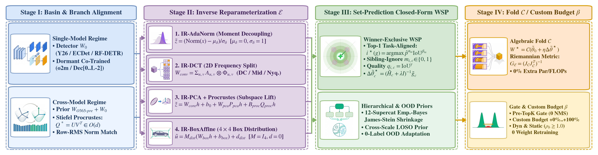

# ODWSP

Implementation of paper - [Reparameterizing Your Object Detectors for Weight Space Programming](https://github.com/WongKinYiu/ODWSP)

[](https://arxiv.org/)
[](https://github.com/WongKinYiu/ODWSP/releases/tag/v0.1.0)
[](./LICENSE)

<div align="center">
    <a href="./">
        
    </a>
</div>


## Performance

MS COCO & Zero-Shot COCO-O (`1.00x` Zero-Overhead Weight-Space Programming, `0%` Extra Params, `0%` Extra FLOPs)

| Model | Test Size | AP<sup>val</sup> | AP<sub>50</sub><sup>val</sup> | AP<sub>75</sub><sup>val</sup> | AP<sub>S</sub><sup>val</sup> | mAP<sup>COCO-O</sup> | Param. | FLOPs |
| :-- | :-: | :-: | :-: | :-: | :-: | :-: | :-: | :-: |
| [**YOLO26-N-ODWSP**](https://github.com/WongKinYiu/ODWSP/releases/download/v0.1.0/yolo26n-odwsp.pt) | 640 | **40.2%** | **55.7%** | **43.6%** | **20.0%** | **18.4%** | **2.57M** | **6.1G** |
| [**YOLO26-S-ODWSP**](https://github.com/WongKinYiu/ODWSP/releases/download/v0.1.0/yolo26s-odwsp.pt) | 640 | **47.9%** | **64.6%** | **52.3%** | **29.5%** | **24.5%** | **10.01M** | **22.8G** |
| [**YOLO26-M-ODWSP**](https://github.com/WongKinYiu/ODWSP/releases/download/v0.1.0/yolo26m-odwsp.pt) | 640 | **52.6%** | **69.8%** | **57.3%** | **36.5%** | **27.5%** | **21.90M** | **75.0G** |
| [**YOLO26-L-ODWSP**](https://github.com/WongKinYiu/ODWSP/releases/download/v0.1.0/yolo26l-odwsp.pt) | 640 | **54.5%** | **71.6%** | **59.6%** | **38.1%** | **29.6%** | **26.30M** | **93.4G** |
| [**YOLO26-X-ODWSP**](https://github.com/WongKinYiu/ODWSP/releases/download/v0.1.0/yolo26x-odwsp.pt) | 640 | **56.9%** | **74.1%** | **62.2%** | **41.5%** | **32.7%** | **58.99M** | **208.9G** |
| [**ECDet-S-ODWSP**](https://github.com/WongKinYiu/ODWSP/releases/download/v0.1.0/ecdet-s-odwsp.pt) | 640 | **51.7%** | **69.5%** | **55.8%** | **32.3%** | **30.1%** | **9.88M** | **50.1G** |
| [**ECDet-M-ODWSP**](https://github.com/WongKinYiu/ODWSP/releases/download/v0.1.0/ecdet-m-odwsp.pt) | 640 | **54.2%** | **72.3%** | **58.7%** | **35.9%** | **35.4%** | **19.43M** | **85.7G** |
| [**ECDet-L-ODWSP**](https://github.com/WongKinYiu/ODWSP/releases/download/v0.1.0/ecdet-l-odwsp.pt) | 640 | **57.0%** | **75.1%** | **61.7%** | **38.7%** | **43.8%** | **32.97M** | **148.3G** |
| [**ECDet-X-ODWSP**](https://github.com/WongKinYiu/ODWSP/releases/download/v0.1.0/ecdet-x-odwsp.pt) | 640 | **57.9%** | **76.0%** | **62.9%** | **38.6%** | **45.4%** | **49.94M** | **208.9G** |
| [**ECDet-O365-S-ODWSP**](https://github.com/WongKinYiu/ODWSP/releases/download/v0.1.0/ecdet-o365coco-s-odwsp.pt) | 640 | **53.6%** | **71.0%** | **58.1%** | **35.2%** | **31.1%** | **9.88M** | **50.1G** |
| [**ECDet-O365-M-ODWSP**](https://github.com/WongKinYiu/ODWSP/releases/download/v0.1.0/ecdet-o365coco-m-odwsp.pt) | 640 | **56.8%** | **74.3%** | **61.8%** | **38.9%** | **37.6%** | **19.43M** | **85.7G** |
| [**ECDet-O365-L-ODWSP**](https://github.com/WongKinYiu/ODWSP/releases/download/v0.1.0/ecdet-o365coco-l-odwsp.pt) | 640 | **59.0%** | **77.0%** | **64.4%** | **42.1%** | **45.2%** | **32.97M** | **148.3G** |
| [**ECDet-O365-X-ODWSP**](https://github.com/WongKinYiu/ODWSP/releases/download/v0.1.0/ecdet-o365coco-x-odwsp.pt) | 640 | **59.9%** | **77.4%** | **65.2%** | **42.4%** | **47.3%** | **49.94M** | **208.9G** |
| [**RF-DETR-N-ODWSP**](https://github.com/WongKinYiu/ODWSP/releases/download/v0.1.0/rfdetr-n-odwsp.pt) | 384 | **48.5%** | **67.5%** | **51.9%** | **25.4%** | **30.1%** | **30.47M** | **31.9G** |
| [**RF-DETR-S-ODWSP**](https://github.com/WongKinYiu/ODWSP/releases/download/v0.1.0/rfdetr-s-odwsp.pt) | 512 | **53.0%** | **72.1%** | **57.2%** | **31.9%** | **32.1%** | **32.11M** | **59.6G** |
| [**RF-DETR-M-ODWSP**](https://github.com/WongKinYiu/ODWSP/releases/download/v0.1.0/rfdetr-m-odwsp.pt) | 576 | **54.9%** | **73.6%** | **59.4%** | **36.2%** | **32.7%** | **33.69M** | **78.6G** |
| [**RF-DETR-L-ODWSP**](https://github.com/WongKinYiu/ODWSP/releases/download/v0.1.0/rfdetr-l-odwsp.pt) | 704 | **56.6%** | **75.1%** | **61.4%** | **39.1%** | **32.4%** | **33.93M** | **125.1G** |

<details><summary> <b>Cross-Basin Symmetry-Aligned Checkpoints (9 O365 + COCO Models) — Expand</b> </summary>

| Model | Test Size | AP<sup>val</sup> | AP<sub>50</sub><sup>val</sup> | AP<sub>75</sub><sup>val</sup> | AP<sub>S</sub><sup>val</sup> | mAP<sup>COCO-O</sup> |
| :-- | :-: | :-: | :-: | :-: | :-: | :-: |
| [**YOLO26-N-Cross-ODWSP**](https://github.com/WongKinYiu/ODWSP/releases/download/v0.1.0/yolo26n-cross-odwsp.pt) | 640 | **40.15%** | **55.69%** | **43.57%** | **20.03%** | **18.42%** |
| [**YOLO26-S-Cross-ODWSP**](https://github.com/WongKinYiu/ODWSP/releases/download/v0.1.0/yolo26s-cross-odwsp.pt) | 640 | **47.90%** | **64.61%** | **52.25%** | **29.47%** | **24.50%** |
| [**YOLO26-M-Cross-ODWSP**](https://github.com/WongKinYiu/ODWSP/releases/download/v0.1.0/yolo26m-cross-odwsp.pt) | 640 | **52.59%** | **69.83%** | **57.34%** | **36.47%** | **27.52%** |
| [**YOLO26-L-Cross-ODWSP**](https://github.com/WongKinYiu/ODWSP/releases/download/v0.1.0/yolo26l-cross-odwsp.pt) | 640 | **54.51%** | **71.59%** | **59.57%** | **38.15%** | **29.64%** |
| [**YOLO26-X-Cross-ODWSP**](https://github.com/WongKinYiu/ODWSP/releases/download/v0.1.0/yolo26x-cross-odwsp.pt) | 640 | **56.92%** | **74.09%** | **62.15%** | **41.54%** | **32.75%** |
| [**ECDet-O365-S-Cross-ODWSP**](https://github.com/WongKinYiu/ODWSP/releases/download/v0.1.0/ecdet-o365coco-s-cross-odwsp.pt) | 640 | **53.57%** | **70.98%** | **58.06%** | **35.13%** | **31.10%** |
| [**ECDet-O365-M-Cross-ODWSP**](https://github.com/WongKinYiu/ODWSP/releases/download/v0.1.0/ecdet-o365coco-m-cross-odwsp.pt) | 640 | **56.76%** | **74.27%** | **61.81%** | **38.81%** | **37.55%** |
| [**ECDet-O365-L-Cross-ODWSP**](https://github.com/WongKinYiu/ODWSP/releases/download/v0.1.0/ecdet-o365coco-l-cross-odwsp.pt) | 640 | **59.05%** | **77.08%** | **64.43%** | **42.13%** | **45.22%** |
| [**ECDet-O365-X-Cross-ODWSP**](https://github.com/WongKinYiu/ODWSP/releases/download/v0.1.0/ecdet-o365coco-x-cross-odwsp.pt) | 640 | **59.90%** | **77.46%** | **65.25%** | **42.44%** | **47.35%** |

</details>

<br/>

Latency-Budget-Aware Deployment Across 17 Pretrained Detectors (`0` Weight Retraining, `0` External NMS)

<div align="center">
    <a href="./">
        
    </a>
</div>

| Deployed Model / Budget $\beta$ | Ext. NMS | PyTorch $B{=}1$ (ms) | TensorRT $B{=}1$ (ms) | 17-Model AP<sup>val</sup> | 17-Model mAP<sup>COCO-O</sup> |
| :-- | :-: | :-: | :-: | :-: | :-: |
| Official (`1.00x`, 0\%) | No | 8.07 | 2.22 | 53.78% | 33.83% |
| **IR-ODWSP** (`1.00x` Folded) | **No** | **8.57** | **2.25** | **53.84%** | **33.88%** |
| Official TTA (`0`-Post) | No | 55.10 | 15.72 | 16.76% | 15.38% |
| Official TTA (NMS) | Yes | 57.30 | 19.03 | 54.98% | 35.77% |
| **IR-ODWSP** (Contraction, -10\%) | **No** | **7.05** | **1.78** | **51.62%** | **33.48%** |
| **IR-ODWSP-Dyn** (+10\%) | **No** | **9.26** | **2.29** | **54.08%** | **33.94%** |
| **IR-ODWSP-Dyn** (+50\%) | **No** | **15.20** | **3.03** | **54.68%** | **34.27%** |
| **IR-ODWSP-SG** (+10\%) | **No** | **8.97** | **2.29** | **54.04%** | **33.94%** |
| **IR-ODWSP-SG** (+100\%) | **No** | **12.69** | **3.91** | **54.83%** | **34.18%** |
| **IR-ODWSP-Auto** (+100\%) | **No** | **12.69** | **3.74** | **54.83%** | **34.18%** |
| **IR-ODWSP+** (Unconstrained Best) | **No** | **291.6** | **208.8** | **55.91%** | **35.44%** |

<details><summary> <b>Multi-Subspace Basin Packs & MM-FW-Ridge Contraction Bridges (v0.1.0) — Expand</b> </summary>

* **Negative-Budget `MM-FW-Ridge` Subgraph Bridges (All 17 Detectors)**: [`odwsp-contraction-bridges-all17.tar.gz`](https://github.com/WongKinYiu/ODWSP/releases/download/v0.1.0/odwsp-contraction-bridges-all17.tar.gz)
* **YOLO26 Multi-Subspace Basins**: [`yolo26n-odwsp-basins.pt`](https://github.com/WongKinYiu/ODWSP/releases/download/v0.1.0/yolo26n-odwsp-basins.pt) [`yolo26s-odwsp-basins.pt`](https://github.com/WongKinYiu/ODWSP/releases/download/v0.1.0/yolo26s-odwsp-basins.pt) [`yolo26m-odwsp-basins.pt`](https://github.com/WongKinYiu/ODWSP/releases/download/v0.1.0/yolo26m-odwsp-basins.pt) [`yolo26l-odwsp-basins.pt`](https://github.com/WongKinYiu/ODWSP/releases/download/v0.1.0/yolo26l-odwsp-basins.pt) [`yolo26x-odwsp-basins.pt`](https://github.com/WongKinYiu/ODWSP/releases/download/v0.1.0/yolo26x-odwsp-basins.pt)
* **ECDet (COCO) Multi-Subspace Basins**: [`ecdet-s-odwsp-basins.pt`](https://github.com/WongKinYiu/ODWSP/releases/download/v0.1.0/ecdet-s-odwsp-basins.pt) [`ecdet-m-odwsp-basins.pt`](https://github.com/WongKinYiu/ODWSP/releases/download/v0.1.0/ecdet-m-odwsp-basins.pt) [`ecdet-l-odwsp-basins.pt`](https://github.com/WongKinYiu/ODWSP/releases/download/v0.1.0/ecdet-l-odwsp-basins.pt) [`ecdet-x-odwsp-basins.pt`](https://github.com/WongKinYiu/ODWSP/releases/download/v0.1.0/ecdet-x-odwsp-basins.pt)
* **ECDet (O365->COCO) Multi-Subspace Basins**: [`ecdet-o365coco-s-odwsp-basins.pt`](https://github.com/WongKinYiu/ODWSP/releases/download/v0.1.0/ecdet-o365coco-s-odwsp-basins.pt) [`ecdet-o365coco-m-odwsp-basins.pt`](https://github.com/WongKinYiu/ODWSP/releases/download/v0.1.0/ecdet-o365coco-m-odwsp-basins.pt) [`ecdet-o365coco-l-odwsp-basins.pt`](https://github.com/WongKinYiu/ODWSP/releases/download/v0.1.0/ecdet-o365coco-l-odwsp-basins.pt) [`ecdet-o365coco-x-odwsp-basins.pt`](https://github.com/WongKinYiu/ODWSP/releases/download/v0.1.0/ecdet-o365coco-x-odwsp-basins.pt)
* **RF-DETR Multi-Subspace Basins**: [`rfdetr-n-odwsp-basins.pt`](https://github.com/WongKinYiu/ODWSP/releases/download/v0.1.0/rfdetr-n-odwsp-basins.pt) [`rfdetr-s-odwsp-basins.pt`](https://github.com/WongKinYiu/ODWSP/releases/download/v0.1.0/rfdetr-s-odwsp-basins.pt) [`rfdetr-m-odwsp-basins.pt`](https://github.com/WongKinYiu/ODWSP/releases/download/v0.1.0/rfdetr-m-odwsp-basins.pt) [`rfdetr-l-odwsp-basins.pt`](https://github.com/WongKinYiu/ODWSP/releases/download/v0.1.0/rfdetr-l-odwsp-basins.pt)
* **Pre-Fused Continuum `state_dict` Deploy Archives**: [`odwsp-deploy-yolo26-nsml.tar.gz`](https://github.com/WongKinYiu/ODWSP/releases/download/v0.1.0/odwsp-deploy-yolo26-nsml.tar.gz) [`odwsp-deploy-yolo26-x.tar.gz`](https://github.com/WongKinYiu/ODWSP/releases/download/v0.1.0/odwsp-deploy-yolo26-x.tar.gz) [`odwsp-deploy-ecdet-sm.tar.gz`](https://github.com/WongKinYiu/ODWSP/releases/download/v0.1.0/odwsp-deploy-ecdet-sm.tar.gz) [`odwsp-deploy-ecdet-lx.tar.gz`](https://github.com/WongKinYiu/ODWSP/releases/download/v0.1.0/odwsp-deploy-ecdet-lx.tar.gz) [`odwsp-deploy-ecdet-o365-sm.tar.gz`](https://github.com/WongKinYiu/ODWSP/releases/download/v0.1.0/odwsp-deploy-ecdet-o365-sm.tar.gz) [`odwsp-deploy-ecdet-o365-lx.tar.gz`](https://github.com/WongKinYiu/ODWSP/releases/download/v0.1.0/odwsp-deploy-ecdet-o365-lx.tar.gz) [`odwsp-deploy-rfdetr-ns.tar.gz`](https://github.com/WongKinYiu/ODWSP/releases/download/v0.1.0/odwsp-deploy-rfdetr-ns.tar.gz) [`odwsp-deploy-rfdetr-ml.tar.gz`](https://github.com/WongKinYiu/ODWSP/releases/download/v0.1.0/odwsp-deploy-rfdetr-ml.tar.gz)
* **Cryptographic Checksums**: [`SHA256SUMS.txt`](https://github.com/WongKinYiu/ODWSP/releases/download/v0.1.0/SHA256SUMS.txt)

</details>


## Installation

Docker environment (recommended)
<details><summary> <b>Expand</b> </summary>

``` shell
# create the docker container
docker run --gpus all --name odwsp -it -v /path/to/coco/:/coco/ -v /path/to/ODWSP/:/odwsp --shm-size=64g nvcr.io/nvidia/pytorch:25.02-py3

# install dependencies and ODWSP package
cd /odwsp
pip install -r requirements.txt
pip install -e .

# (optional) build custom CUDA C++ TensorRT IPluginV3 shared libraries
bash csrc/build_plugins.sh
```

</details>

Local Python environment
<details><summary> <b>Expand</b> </summary>

``` shell
git clone https://github.com/WongKinYiu/ODWSP.git
cd ODWSP
pip install -r requirements.txt
pip install -e .

# run zero-gradient & mathematical equivalence unit tests
python tests/test_odwsp.py -v
```

</details>


## Evaluation

[`yolo26n-odwsp.pt`](https://github.com/WongKinYiu/ODWSP/releases/download/v0.1.0/yolo26n-odwsp.pt) [`yolo26s-odwsp.pt`](https://github.com/WongKinYiu/ODWSP/releases/download/v0.1.0/yolo26s-odwsp.pt) [`yolo26m-odwsp.pt`](https://github.com/WongKinYiu/ODWSP/releases/download/v0.1.0/yolo26m-odwsp.pt) [`yolo26l-odwsp.pt`](https://github.com/WongKinYiu/ODWSP/releases/download/v0.1.0/yolo26l-odwsp.pt) [`yolo26x-odwsp.pt`](https://github.com/WongKinYiu/ODWSP/releases/download/v0.1.0/yolo26x-odwsp.pt)
[`ecdet-s-odwsp.pt`](https://github.com/WongKinYiu/ODWSP/releases/download/v0.1.0/ecdet-s-odwsp.pt) [`ecdet-m-odwsp.pt`](https://github.com/WongKinYiu/ODWSP/releases/download/v0.1.0/ecdet-m-odwsp.pt) [`ecdet-l-odwsp.pt`](https://github.com/WongKinYiu/ODWSP/releases/download/v0.1.0/ecdet-l-odwsp.pt) [`ecdet-x-odwsp.pt`](https://github.com/WongKinYiu/ODWSP/releases/download/v0.1.0/ecdet-x-odwsp.pt)
[`rfdetr-n-odwsp.pt`](https://github.com/WongKinYiu/ODWSP/releases/download/v0.1.0/rfdetr-n-odwsp.pt) [`rfdetr-s-odwsp.pt`](https://github.com/WongKinYiu/ODWSP/releases/download/v0.1.0/rfdetr-s-odwsp.pt) [`rfdetr-m-odwsp.pt`](https://github.com/WongKinYiu/ODWSP/releases/download/v0.1.0/rfdetr-m-odwsp.pt) [`rfdetr-l-odwsp.pt`](https://github.com/WongKinYiu/ODWSP/releases/download/v0.1.0/rfdetr-l-odwsp.pt)

``` shell
# evaluate YOLO26-S IR-ODWSP on MS COCO val2017 and zero-shot COCO-O
python val.py --model yolo26s --weights ./yolo26s-odwsp.pt --coco-root /coco --coco-o-root /coco_o --device 0 --save-json ./runs/val/yolo26s_odwsp.json

# evaluate RF-DETR-M IR-ODWSP
python val.py --model rfdetr_m --weights ./rfdetr-m-odwsp.pt --coco-root /coco --device 0

# evaluate EdgeCrafter-X (O365->COCO) IR-ODWSP (requires official EdgeCrafter repo path)
python val.py --model ecdet_o365coco_x --weights ./ecdet-o365coco-x-odwsp.pt --edgecrafter-root ./EdgeCrafter --coco-root /coco --device 0
```

You will get the results (example for `yolo26s-odwsp.pt` on MS COCO `val2017`):

```
 Average Precision  (AP) @[ IoU=0.50:0.95 | area=   all | maxDets=100 ] = 0.479
 Average Precision  (AP) @[ IoU=0.50      | area=   all | maxDets=100 ] = 0.646
 Average Precision  (AP) @[ IoU=0.75      | area=   all | maxDets=100 ] = 0.523
 Average Precision  (AP) @[ IoU=0.50:0.95 | area= small | maxDets=100 ] = 0.295
 Average Precision  (AP) @[ IoU=0.50:0.95 | area=medium | maxDets=100 ] = 0.527
 Average Precision  (AP) @[ IoU=0.50:0.95 | area= large | maxDets=100 ] = 0.643
```


## Re-parameterization & Zero-Gradient Calibration

<div align="center">
    <a href="./">
        
    </a>
</div>

``` shell
# run Algorithm 1 (IR-ODWSP): exact function-preserving lift (E), winner-exclusive normal equations, and re-collapse (C)
python calibrate.py --eta-head 0.20 --lam-reg 2800.0 --pca-rank 64 --device 0 --out ./runs/calibrate/collapsed_readout.pt
```


## Deployment (CUDA Graph & TensorRT FP16)

``` shell
# benchmark PyTorch + static CUDAGraph latency (B=1)
python deploy.py --model yolo26s --weights ./yolo26s-odwsp.pt --batch-size 1 --fp16 --cudagraph --benchmark --device 0

# export constant-shape ONNX and compile local Strongly-Typed FP16 TensorRT engine
python deploy.py --model yolo26s --weights ./yolo26s-odwsp.pt --batch-size 1 --fp16 --export-trt ./runs/trt/yolo26s_fp16.plan --device 0
```


## Inference

<div align="center">
    <a href="./">
        
    </a>
</div>

``` shell
# run visual detection inference on images
python detect.py --model yolo26s --weights ./yolo26s-odwsp.pt --source ./images --conf 0.25 --device 0 --output ./runs/detect
```


## Citation

```bibtex
@article{wang2026odwsp,
  title={Reparameterizing Your Object Detectors for Weight Space Programming},
  author={Wang, Chien-Yao},
  journal={arXiv preprint},
  year={2026}
}
```


## Acknowledgements

<details><summary> <b>Expand</b> </summary>

This work was supported in part by Academia Sinica under Grant AS-IAIA-114-M11 and by the National Science and Technology Council (NSTC), Taiwan, under Grant NSTC115-2628-E-001-002-. We also thank the National Center for High-performance Computing (NCHC) for computational and storage resources.

* [https://github.com/WongKinYiu/yolov9](https://github.com/WongKinYiu/yolov9)
* [https://github.com/WongKinYiu/yolov7](https://github.com/WongKinYiu/yolov7)
* [https://github.com/DingXiaoH/RepVGG](https://github.com/DingXiaoH/RepVGG)
* [https://github.com/ultralytics/ultralytics](https://github.com/ultralytics/ultralytics)
* [https://github.com/Intellindust-AI-Lab/EdgeCrafter](https://github.com/Intellindust-AI-Lab/EdgeCrafter)
* [https://github.com/roboflow/rf-detr](https://github.com/roboflow/rf-detr)

**Checkpoint License Note:** The `ODWSP` source code in this repository is licensed under the [MIT License](./LICENSE). Released detector checkpoints inherit the licenses of their respective upstream pretrained models (`YOLO26`: AGPL-3.0; `EdgeCrafter`: Intellindust Non-Commercial License; `RF-DETR`: Apache-2.0).

</details>
