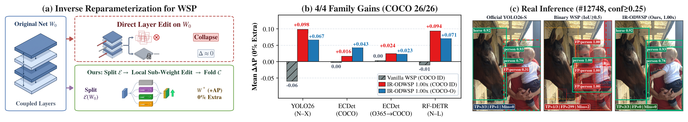
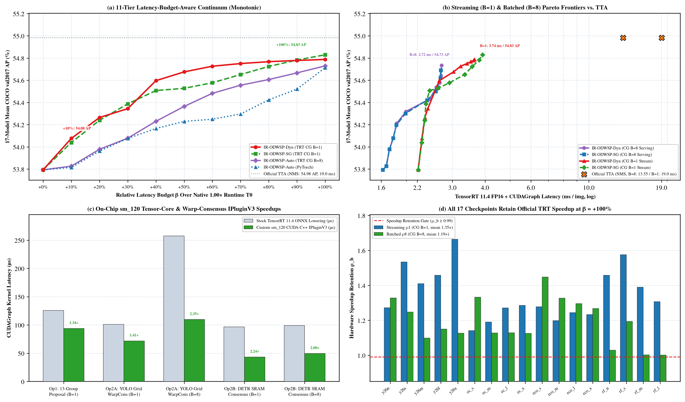
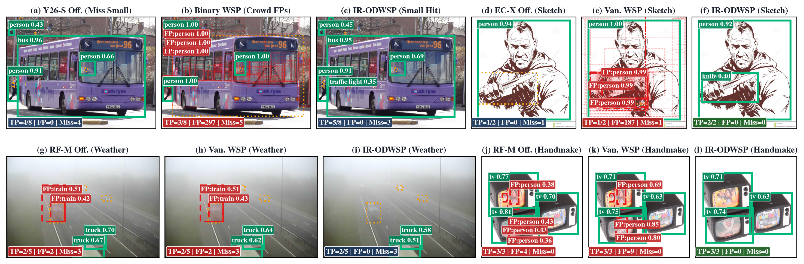
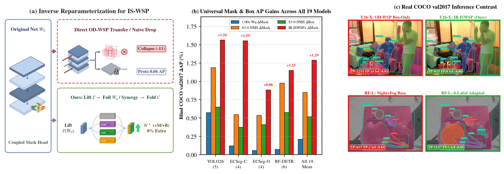
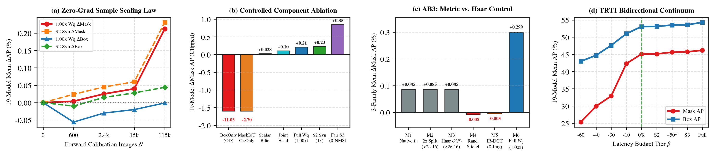

# ODWSP

Implementation of papers in [ODWSP](https://github.com/WongKinYiu/ODWSP):
* **Object Detection (`IR-ODWSP`, `v0.1.0`)** — [Reparameterizing Your Object Detectors for Weight Space Programming](https://arxiv.org/abs/2611.29882)
* **Instance Segmentation (`IR-ISWSP`, added in `v0.1.1`)** — [Reparameterizing Your Instance Segmenter for Weight Space Programming](./ISWSP.md)

[](https://arxiv.org/abs/2611.29882)
[](https://github.com/WongKinYiu/ODWSP/releases/tag/v0.1.1)
[](https://github.com/WongKinYiu/ODWSP/releases/tag/v0.1.0)
[](./LICENSE)

<div align="center">
    <a href="./">
        
    </a>
</div>


## Performance

MS COCO & Zero-Shot COCO-O (`1.00x` Zero-Overhead Weight-Space Programming, `0%` Extra Params, `0%` Extra FLOPs)

<details><summary> <b>Expand</b> </summary>
    
| Model | Test Size | AP<sup>val</sup> | AP<sub>50</sub><sup>val</sup> | AP<sub>75</sub><sup>val</sup> | AP<sub>S</sub><sup>val</sup> | mAP<sup>COCO-O</sup> | Param. | FLOPs |
| :-- | :-: | :-: | :-: | :-: | :-: | :-: | :-: | :-: |
| [**YOLO26-N-ODWSP**](https://github.com/WongKinYiu/ODWSP/releases/download/v0.1.0/yolo26n-odwsp.pt) | 640 | **40.2%** | **55.7%** | **43.6%** | **20.0%** | **18.4%** | **2.57M** | **6.1G** |
| [**YOLO26-S-ODWSP**](https://github.com/WongKinYiu/ODWSP/releases/download/v0.1.0/yolo26s-odwsp.pt) | 640 | **47.9%** | **64.6%** | **52.3%** | **29.5%** | **24.5%** | **10.01M** | **22.8G** |
| [**YOLO26-M-ODWSP**](https://github.com/WongKinYiu/ODWSP/releases/download/v0.1.0/yolo26m-odwsp.pt) | 640 | **52.6%** | **69.8%** | **57.3%** | **36.5%** | **27.5%** | **21.90M** | **75.0G** |
| [**YOLO26-L-ODWSP**](https://github.com/WongKinYiu/ODWSP/releases/download/v0.1.0/yolo26l-odwsp.pt) | 640 | **54.5%** | **71.6%** | **59.6%** | **38.1%** | **29.6%** | **26.30M** | **93.4G** |
| [**YOLO26-X-ODWSP**](https://github.com/WongKinYiu/ODWSP/releases/download/v0.1.0/yolo26x-odwsp.pt) | 640 | **56.9%** | **74.1%** | **62.2%** | **41.5%** | **32.7%** | **58.99M** | **208.9G** |
| [**ECDet-S-ODWSP**](https://github.com/WongKinYiu/ODWSP/releases/download/v0.1.0/ecdet-s-odwsp.pt) | 640 | **51.7%** | **69.5%** | **55.8%** | **32.3%** | **30.1%** | **9.88M** | **50.1G** |
| [**ECDet-M-ODWSP**](https://github.com/WongKinYiu/ODWSP/releases/download/v0.1.0/ecdet-m-odwsp.pt) | 640 | **54.2%** | **72.3%** | **58.7%** | **35.9%** | **35.4%** | **19.43M** | **85.7G** |
| [**ECDet-L-ODWSP**](https://github.com/WongKinYiu/ODWSP/releases/download/v0.1.0/ecdet-l-odwsp.pt) | 640 | **57.0%** | **75.1%** | **61.7%** | **38.7%** | **43.8%** | **32.97M** | **148.3G** |
| [**ECDet-X-ODWSP**](https://github.com/WongKinYiu/ODWSP/releases/download/v0.1.0/ecdet-x-odwsp.pt) | 640 | **57.9%** | **76.0%** | **62.9%** | **38.6%** | **45.4%** | **49.94M** | **208.9G** |
| [**ECDet-O365-S-ODWSP**](https://github.com/WongKinYiu/ODWSP/releases/download/v0.1.0/ecdet-o365coco-s-odwsp.pt) | 640 | **53.6%** | **71.0%** | **58.1%** | **35.2%** | **31.1%** | **9.88M** | **50.1G** |
| [**ECDet-O365-M-ODWSP**](https://github.com/WongKinYiu/ODWSP/releases/download/v0.1.0/ecdet-o365coco-m-odwsp.pt) | 640 | **56.8%** | **74.3%** | **61.8%** | **38.9%** | **37.6%** | **19.43M** | **85.7G** |
| [**ECDet-O365-L-ODWSP**](https://github.com/WongKinYiu/ODWSP/releases/download/v0.1.0/ecdet-o365coco-l-odwsp.pt) | 640 | **59.0%** | **77.0%** | **64.4%** | **42.1%** | **45.2%** | **32.97M** | **148.3G** |
| [**ECDet-O365-X-ODWSP**](https://github.com/WongKinYiu/ODWSP/releases/download/v0.1.0/ecdet-o365coco-x-odwsp.pt) | 640 | **59.9%** | **77.4%** | **65.2%** | **42.4%** | **47.3%** | **49.94M** | **208.9G** |
| [**RF-DETR-N-ODWSP**](https://github.com/WongKinYiu/ODWSP/releases/download/v0.1.0/rfdetr-n-odwsp.pt) | 384 | **48.5%** | **67.5%** | **51.9%** | **25.4%** | **30.1%** | **30.47M** | **31.9G** |
| [**RF-DETR-S-ODWSP**](https://github.com/WongKinYiu/ODWSP/releases/download/v0.1.0/rfdetr-s-odwsp.pt) | 512 | **53.0%** | **72.1%** | **57.2%** | **31.9%** | **32.1%** | **32.11M** | **59.6G** |
| [**RF-DETR-M-ODWSP**](https://github.com/WongKinYiu/ODWSP/releases/download/v0.1.0/rfdetr-m-odwsp.pt) | 576 | **54.9%** | **73.6%** | **59.4%** | **36.2%** | **32.7%** | **33.69M** | **78.6G** |
| [**RF-DETR-L-ODWSP**](https://github.com/WongKinYiu/ODWSP/releases/download/v0.1.0/rfdetr-l-odwsp.pt) | 704 | **56.6%** | **75.1%** | **61.4%** | **39.1%** | **32.4%** | **33.93M** | **125.1G** |

</details>

<details><summary> <b>Cross-Basin Symmetry-Aligned Checkpoints (9 O365 + COCO Models) — Expand</b> </summary>

| Model | Test Size | AP<sup>val</sup> | AP<sub>50</sub><sup>val</sup> | AP<sub>75</sub><sup>val</sup> | AP<sub>S</sub><sup>val</sup> | mAP<sup>COCO-O</sup> |
| :-- | :-: | :-: | :-: | :-: | :-: | :-: |
| [**YOLO26-N-Cross-ODWSP**](https://github.com/WongKinYiu/ODWSP/releases/download/v0.1.0/yolo26n-cross-odwsp.pt) | 640 | **40.15%** | **55.69%** | **43.57%** | **20.03%** | **18.42%** |
| [**YOLO26-S-Cross-ODWSP**](https://github.com/WongKinYiu/ODWSP/releases/download/v0.1.0/yolo26s-cross-odwsp.pt) | 640 | **47.90%** | **64.61%** | **52.25%** | **29.47%** | **24.50%** |
| [**YOLO26-M-Cross-ODWSP**](https://github.com/WongKinYiu/ODWSP/releases/download/v0.1.0/yolo26m-cross-odwsp.pt) | 640 | **52.59%** | **69.83%** | **57.34%** | **36.47%** | **27.52%** |
| [**YOLO26-L-Cross-ODWSP**](https://github.com/WongKinYiu/ODWSP/releases/download/v0.1.0/yolo26l-cross-odwsp.pt) | 640 | **54.51%** | **71.59%** | **59.57%** | **38.15%** | **29.64%** |
| [**YOLO26-X-Cross-ODWSP**](https://github.com/WongKinYiu/ODWSP/releases/download/v0.1.0/yolo26x-cross-odwsp.pt) | 640 | **56.92%** | **74.09%** | **62.15%** | **41.54%** | **32.75%** |
| [**ECDet-O365-S-Cross-ODWSP**](https://github.com/WongKinYiu/ODWSP/releases/download/v0.1.0/ecdet-o365coco-s-cross-odwsp.pt) | 640 | **53.57%** | **70.98%** | **58.06%** | **35.13%** | **31.10%** |
| [**ECDet-O365-M-Cross-ODWSP**](https://github.com/WongKinYiu/ODWSP/releases/download/v0.1.0/ecdet-o365coco-m-cross-odwsp.pt) | 640 | **56.76%** | **74.27%** | **61.81%** | **38.81%** | **37.55%** |
| [**ECDet-O365-L-Cross-ODWSP**](https://github.com/WongKinYiu/ODWSP/releases/download/v0.1.0/ecdet-o365coco-l-cross-odwsp.pt) | 640 | **59.05%** | **77.08%** | **64.43%** | **42.13%** | **45.22%** |
| [**ECDet-O365-X-Cross-ODWSP**](https://github.com/WongKinYiu/ODWSP/releases/download/v0.1.0/ecdet-o365coco-x-cross-odwsp.pt) | 640 | **59.90%** | **77.46%** | **65.25%** | **42.44%** | **47.35%** |

</details>

<br/>

Latency-Budget-Aware Deployment Across 17 Pretrained Detectors (`0` Weight Retraining, `0` External NMS)

<div align="center">
    <a href="./">
        
    </a>
</div>

| Deployed Model / Budget $\beta$ | Ext. NMS | PyTorch $B{=}1$ (ms) | TensorRT $B{=}1$ (ms) | 17-Model AP<sup>val</sup> | 17-Model mAP<sup>COCO-O</sup> |
| :-- | :-: | :-: | :-: | :-: | :-: |
| Official (`1.00x`, $\beta=0\%$) | No | 8.07 | 2.22 | 53.78% | 33.83% |
| **IR-ODWSP** (`1.00x` Folded) | **No** | **8.57** | **2.25** | **53.84%** | **33.88%** |
| Official TTA (`0`-Post) | No | 55.10 | 15.72 | 16.76% | 15.38% |
| Official TTA (NMS) | Yes | 57.30 | 19.03 | 54.98% | 35.77% |
| **IR-ODWSP** (Contraction, $\beta \le -10\%$) | **No** | **7.05** | **1.78** | **51.62%** | **33.48%** |
| **IR-ODWSP-Dyn** ($\beta \le +10\%$) | **No** | **9.26** | **2.29** | **54.08%** | **33.94%** |
| **IR-ODWSP-Dyn** ($\beta \le +50\%$) | **No** | **15.20** | **3.03** | **54.68%** | **34.27%** |
| **IR-ODWSP-SG** ($\beta \le +10\%$) | **No** | **8.97** | **2.29** | **54.04%** | **33.94%** |
| **IR-ODWSP-SG** ($\beta \le +100\%$) | **No** | **12.69** | **3.91** | **54.83%** | **34.18%** |
| **IR-ODWSP-Auto** ($\beta \le +100\%$) | **No** | **12.69** | **3.74** | **54.83%** | **34.18%** |
| **IR-ODWSP+** (Unconstrained Best) | **No** | **291.6** | **208.8** | **55.91%** | **35.44%** |

<details><summary> <b>Multi-Subspace Basin Packs & MM-FW-Ridge Contraction Bridges (v0.1.0) — Expand</b> </summary>

* **Negative-Budget `MM-FW-Ridge` Subgraph Bridges (All 17 Detectors)**: [`odwsp-contraction-bridges-all17.tar.gz`](https://github.com/WongKinYiu/ODWSP/releases/download/v0.1.0/odwsp-contraction-bridges-all17.tar.gz)
* **YOLO26 Multi-Subspace Basins**: [`yolo26n-odwsp-basins.pt`](https://github.com/WongKinYiu/ODWSP/releases/download/v0.1.0/yolo26n-odwsp-basins.pt) [`yolo26s-odwsp-basins.pt`](https://github.com/WongKinYiu/ODWSP/releases/download/v0.1.0/yolo26s-odwsp-basins.pt) [`yolo26m-odwsp-basins.pt`](https://github.com/WongKinYiu/ODWSP/releases/download/v0.1.0/yolo26m-odwsp-basins.pt) [`yolo26l-odwsp-basins.pt`](https://github.com/WongKinYiu/ODWSP/releases/download/v0.1.0/yolo26l-odwsp-basins.pt) [`yolo26x-odwsp-basins.pt`](https://github.com/WongKinYiu/ODWSP/releases/download/v0.1.0/yolo26x-odwsp-basins.pt)
* **ECDet (COCO) Multi-Subspace Basins**: [`ecdet-s-odwsp-basins.pt`](https://github.com/WongKinYiu/ODWSP/releases/download/v0.1.0/ecdet-s-odwsp-basins.pt) [`ecdet-m-odwsp-basins.pt`](https://github.com/WongKinYiu/ODWSP/releases/download/v0.1.0/ecdet-m-odwsp-basins.pt) [`ecdet-l-odwsp-basins.pt`](https://github.com/WongKinYiu/ODWSP/releases/download/v0.1.0/ecdet-l-odwsp-basins.pt) [`ecdet-x-odwsp-basins.pt`](https://github.com/WongKinYiu/ODWSP/releases/download/v0.1.0/ecdet-x-odwsp-basins.pt)
* **ECDet (O365->COCO) Multi-Subspace Basins**: [`ecdet-o365coco-s-odwsp-basins.pt`](https://github.com/WongKinYiu/ODWSP/releases/download/v0.1.0/ecdet-o365coco-s-odwsp-basins.pt) [`ecdet-o365coco-m-odwsp-basins.pt`](https://github.com/WongKinYiu/ODWSP/releases/download/v0.1.0/ecdet-o365coco-m-odwsp-basins.pt) [`ecdet-o365coco-l-odwsp-basins.pt`](https://github.com/WongKinYiu/ODWSP/releases/download/v0.1.0/ecdet-o365coco-l-odwsp-basins.pt) [`ecdet-o365coco-x-odwsp-basins.pt`](https://github.com/WongKinYiu/ODWSP/releases/download/v0.1.0/ecdet-o365coco-x-odwsp-basins.pt)
* **RF-DETR Multi-Subspace Basins**: [`rfdetr-n-odwsp-basins.pt`](https://github.com/WongKinYiu/ODWSP/releases/download/v0.1.0/rfdetr-n-odwsp-basins.pt) [`rfdetr-s-odwsp-basins.pt`](https://github.com/WongKinYiu/ODWSP/releases/download/v0.1.0/rfdetr-s-odwsp-basins.pt) [`rfdetr-m-odwsp-basins.pt`](https://github.com/WongKinYiu/ODWSP/releases/download/v0.1.0/rfdetr-m-odwsp-basins.pt) [`rfdetr-l-odwsp-basins.pt`](https://github.com/WongKinYiu/ODWSP/releases/download/v0.1.0/rfdetr-l-odwsp-basins.pt)
* **Pre-Fused Continuum `state_dict` Deploy Archives**: [`odwsp-deploy-yolo26-nsml.tar.gz`](https://github.com/WongKinYiu/ODWSP/releases/download/v0.1.0/odwsp-deploy-yolo26-nsml.tar.gz) [`odwsp-deploy-yolo26-x.tar.gz`](https://github.com/WongKinYiu/ODWSP/releases/download/v0.1.0/odwsp-deploy-yolo26-x.tar.gz) [`odwsp-deploy-ecdet-sm.tar.gz`](https://github.com/WongKinYiu/ODWSP/releases/download/v0.1.0/odwsp-deploy-ecdet-sm.tar.gz) [`odwsp-deploy-ecdet-lx.tar.gz`](https://github.com/WongKinYiu/ODWSP/releases/download/v0.1.0/odwsp-deploy-ecdet-lx.tar.gz) [`odwsp-deploy-ecdet-o365-sm.tar.gz`](https://github.com/WongKinYiu/ODWSP/releases/download/v0.1.0/odwsp-deploy-ecdet-o365-sm.tar.gz) [`odwsp-deploy-ecdet-o365-lx.tar.gz`](https://github.com/WongKinYiu/ODWSP/releases/download/v0.1.0/odwsp-deploy-ecdet-o365-lx.tar.gz) [`odwsp-deploy-rfdetr-ns.tar.gz`](https://github.com/WongKinYiu/ODWSP/releases/download/v0.1.0/odwsp-deploy-rfdetr-ns.tar.gz) [`odwsp-deploy-rfdetr-ml.tar.gz`](https://github.com/WongKinYiu/ODWSP/releases/download/v0.1.0/odwsp-deploy-rfdetr-ml.tar.gz)
* **Cryptographic Checksums**: [`SHA256SUMS.txt`](https://github.com/WongKinYiu/ODWSP/releases/download/v0.1.0/SHA256SUMS.txt)

</details>


## Installation

Docker environment (recommended)
<details><summary> <b>Expand</b> </summary>

``` shell
# create the docker container
docker run --gpus all --name odwsp -it -v /path/to/coco/:/coco/ -v /path/to/ODWSP/:/odwsp --shm-size=64g nvcr.io/nvidia/pytorch:25.02-py3

# install dependencies and ODWSP package
cd /odwsp
pip install -r requirements.txt
pip install -e .

# (optional) build custom CUDA C++ TensorRT IPluginV3 shared libraries
bash csrc/build_plugins.sh
```

</details>

Local Python environment
<details><summary> <b>Expand</b> </summary>

``` shell
git clone https://github.com/WongKinYiu/ODWSP.git
cd ODWSP
pip install -r requirements.txt
pip install -e .

# run zero-gradient & mathematical equivalence unit tests (ODWSP + ISWSP)
python tests/test_odwsp.py -v
python tests/test_iswsp.py -v
```

</details>


## Evaluation

[`yolo26n-odwsp.pt`](https://github.com/WongKinYiu/ODWSP/releases/download/v0.1.0/yolo26n-odwsp.pt) [`yolo26s-odwsp.pt`](https://github.com/WongKinYiu/ODWSP/releases/download/v0.1.0/yolo26s-odwsp.pt) [`yolo26m-odwsp.pt`](https://github.com/WongKinYiu/ODWSP/releases/download/v0.1.0/yolo26m-odwsp.pt) [`yolo26l-odwsp.pt`](https://github.com/WongKinYiu/ODWSP/releases/download/v0.1.0/yolo26l-odwsp.pt) [`yolo26x-odwsp.pt`](https://github.com/WongKinYiu/ODWSP/releases/download/v0.1.0/yolo26x-odwsp.pt)
[`ecdet-s-odwsp.pt`](https://github.com/WongKinYiu/ODWSP/releases/download/v0.1.0/ecdet-s-odwsp.pt) [`ecdet-m-odwsp.pt`](https://github.com/WongKinYiu/ODWSP/releases/download/v0.1.0/ecdet-m-odwsp.pt) [`ecdet-l-odwsp.pt`](https://github.com/WongKinYiu/ODWSP/releases/download/v0.1.0/ecdet-l-odwsp.pt) [`ecdet-x-odwsp.pt`](https://github.com/WongKinYiu/ODWSP/releases/download/v0.1.0/ecdet-x-odwsp.pt)
[`rfdetr-n-odwsp.pt`](https://github.com/WongKinYiu/ODWSP/releases/download/v0.1.0/rfdetr-n-odwsp.pt) [`rfdetr-s-odwsp.pt`](https://github.com/WongKinYiu/ODWSP/releases/download/v0.1.0/rfdetr-s-odwsp.pt) [`rfdetr-m-odwsp.pt`](https://github.com/WongKinYiu/ODWSP/releases/download/v0.1.0/rfdetr-m-odwsp.pt) [`rfdetr-l-odwsp.pt`](https://github.com/WongKinYiu/ODWSP/releases/download/v0.1.0/rfdetr-l-odwsp.pt)

``` shell
# 1) 1.00x zero-overhead IR-ODWSP (--budget 0%, 0% extra params, 0% extra FLOPs)
python val.py --model yolo26s --weights ./yolo26s-odwsp.pt --coco-root /coco --coco-o-root /coco_o --device 0 --save-json ./runs/val/yolo26s_odwsp.json

# evaluate RF-DETR-M & EdgeCrafter-X (O365->COCO) at 1.00x
python val.py --model rfdetr_m --weights ./rfdetr-m-odwsp.pt --coco-root /coco --device 0
python val.py --model ecdet_o365coco_x --weights ./ecdet-o365coco-x-odwsp.pt --edgecrafter-root ./EdgeCrafter --coco-root /coco --device 0

# 2) Negative latency budget (e.g., --budget -10% or -50% MM-FW-Ridge contraction, 0 external NMS)
python val.py --model yolo26s --budget -10% --basins ./yolo26s-odwsp-basins.pt --bridges ./odwsp-contraction-bridges-all17.tar.gz --coco-root /coco --device 0

# 3) Positive latency budget (e.g., --budget +10%, +50%, +100% with --paradigm {auto, dyn, sg})
python val.py --model yolo26s --budget +50% --paradigm auto --basins ./yolo26s-odwsp-basins.pt --coco-root /coco --device 0

# 4) Unconstrained accuracy ceiling (--budget full, IR-ODWSP+)
python val.py --model yolo26s --budget full --basins ./yolo26s-odwsp-basins.pt --coco-root /coco --device 0
```

You will get the results (example for `yolo26s-odwsp.pt` on MS COCO `val2017`):

```
 Average Precision  (AP) @[ IoU=0.50:0.95 | area=   all | maxDets=100 ] = 0.479
 Average Precision  (AP) @[ IoU=0.50      | area=   all | maxDets=100 ] = 0.646
 Average Precision  (AP) @[ IoU=0.75      | area=   all | maxDets=100 ] = 0.523
 Average Precision  (AP) @[ IoU=0.50:0.95 | area= small | maxDets=100 ] = 0.295
 Average Precision  (AP) @[ IoU=0.50:0.95 | area=medium | maxDets=100 ] = 0.527
 Average Precision  (AP) @[ IoU=0.50:0.95 | area= large | maxDets=100 ] = 0.643
```


## Re-parameterization & Zero-Gradient Calibration

<div align="center">
    <a href="./">
        
    </a>
</div>

``` shell
# 1) End-to-end zero-gradient detector WSP calibration on COCO-format images (Algorithm 1: E -> Solve -> C)
python calibrate.py --mode detector --model yolo26s --pretrained ./yolo26s-raw-statedict.pt --coco-root /coco --split train2017 --max-images 2400 --device 0 --out ./runs/calibrate/yolo26s-odwsp.pt

# 2) Closed-form MM-FW-Ridge subgraph bridge calibration for negative budgets (beta < 0%)
python calibrate.py --mode bridge --lam-rel 0.015 --moment-gain 1.85 --device 0 --out ./runs/calibrate/mm_fw_bridge.pt

# 3) Standalone readout calibration & exact IEEE-754 FP32 collapse verification
python calibrate.py --mode readout --eta-head 0.20 --lam-reg 2800.0 --pca-rank 64 --device 0 --out ./runs/calibrate/collapsed_readout.pt
```


## Deployment (Latency-Budget Continuum, CUDA Graph & TensorRT FP16)

``` shell
# inspect all 22 bidirectional budget tiers (-100% to +100% & full) for any model
python deploy.py --model yolo26s --paradigm auto --list-budgets

# benchmark 1.00x (--budget 0%), negative (--budget -10%), or positive (--budget +50%) inside a static CUDAGraph
python deploy.py --model yolo26s --weights ./yolo26s-odwsp.pt --batch-size 1 --fp16 --cudagraph --benchmark --device 0
python deploy.py --model yolo26s --budget -10% --basins ./yolo26s-odwsp-basins.pt --bridges ./odwsp-contraction-bridges-all17.tar.gz --batch-size 1 --fp16 --cudagraph --benchmark --device 0
python deploy.py --model yolo26s --budget +50% --paradigm auto --basins ./yolo26s-odwsp-basins.pt --batch-size 1 --fp16 --cudagraph --benchmark --device 0

# solve g*(beta) live on your own target GPU (profiles T_0 and T(g) directly on your hardware)
python deploy.py --model yolo26s --budget +30% --paradigm auto --basins ./yolo26s-odwsp-basins.pt --solve-on-gpu --fp16 --cudagraph --device 0

# export constant-shape ONNX and compile local Strongly-Typed FP16 TensorRT engine at any budget
python deploy.py --model yolo26s --budget +50% --paradigm sg --basins ./yolo26s-odwsp-basins.pt --batch-size 1 --fp16 --export-trt ./runs/trt/yolo26s_pos50_fp16.plan --device 0
```


## Inference

<div align="center">
    <a href="./">
        
    </a>
</div>

``` shell
# 1.00x zero-overhead visual detection inference
python detect.py --model yolo26s --weights ./yolo26s-odwsp.pt --source ./images --conf 0.25 --device 0 --output ./runs/detect/1x

# multi-budget visual inference (e.g., --budget -30%, +50%, or full)
python detect.py --model yolo26s --budget -30% --basins ./yolo26s-odwsp-basins.pt --bridges ./odwsp-contraction-bridges-all17.tar.gz --source ./images --conf 0.25 --device 0 --output ./runs/detect/neg30
python detect.py --model yolo26s --budget +50% --paradigm auto --basins ./yolo26s-odwsp-basins.pt --source ./images --conf 0.25 --device 0 --output ./runs/detect/pos50
```


## Instance Segmentation — IR-ISWSP (`v0.1.1`)

`v0.1.1` adds **IR-ISWSP** (*Reparameterizing Your Instance Segmenter for Weight Space Programming*) across **19 official pretrained instance segmenters** (`YOLO26-Seg`, `EdgeCrafter-Seg / ECSeg`, and `RF-DETR-Seg`) with `0` backpropagation, `0` external NMS / Mask-NMS, and full backward compatibility with all `v0.1.0` ODWSP APIs and checkpoints. See [`ISWSP.md`](./ISWSP.md) for the complete architecture, operator, and deployment guide.

<div align="center">
    <a href="./ISWSP.md">
        
    </a>
</div>

MS COCO `val2017` (`1.00x` Zero-Overhead Full-Matrix $\mathbf{W}_q$ IR-ISWSP, `0%` Extra Params, `0%` Extra FLOPs, `v0.1.1` Release)

<details><summary> <b>Expand (19 Instance Segmenters — `v0.1.1` Weights)</b> </summary>

| Model | Test Size | Mask AP<sup>val</sup> | Mask AP<sub>75</sub><sup>val</sup> | Mask AP<sub>S</sub><sup>val</sup> | Box AP<sup>val</sup> | `S2` Mask / Box | `IR-ISWSP+` Mask / Box | Param. |
| :-- | :-: | :-: | :-: | :-: | :-: | :-: | :-: | :-: |
| [**YOLO26-N-Seg-ISWSP**](https://github.com/WongKinYiu/ODWSP/releases/download/v0.1.1/yolo26n-seg-iswsp.pt) | 640 | **33.98%** (+0.36) | **36.33%** | **14.54%** | 39.59% | 33.98 / 39.59 | **35.58 / 41.56** | **3.13M** |
| [**YOLO26-S-Seg-ISWSP**](https://github.com/WongKinYiu/ODWSP/releases/download/v0.1.1/yolo26s-seg-iswsp.pt) | 640 | **40.14%** (+0.49) | **43.27%** | **20.65%** | 47.22% | 40.14 / 47.22 | **41.25 / 48.98** | **11.51M** |
| [**YOLO26-M-Seg-ISWSP**](https://github.com/WongKinYiu/ODWSP/releases/download/v0.1.1/yolo26m-seg-iswsp.pt) | 640 | **44.21%** (+0.61) | **48.23%** | **26.09%** | 52.16% | 44.20 / 52.16 | **45.13 / 53.62** | **27.11M** |
| [**YOLO26-L-Seg-ISWSP**](https://github.com/WongKinYiu/ODWSP/releases/download/v0.1.1/yolo26l-seg-iswsp.pt) | 640 | **45.70%** (+0.63) | **49.84%** | **27.21%** | 54.27% | 45.70 / 54.27 | **46.53 / 55.58** | **31.52M** |
| [**YOLO26-X-Seg-ISWSP**](https://github.com/WongKinYiu/ODWSP/releases/download/v0.1.1/yolo26x-seg-iswsp.pt) | 640 | **47.34%** (+0.78) | **51.71%** | **30.59%** | 56.25% | 47.34 / **56.25** | **47.83 / 57.26** | **70.69M** |
| [**ECSeg-S-ISWSP**](https://github.com/WongKinYiu/ODWSP/releases/download/v0.1.1/ecseg-s-iswsp.pt) | 640 | **43.10%** (+0.26) | **46.14%** | **23.54%** | 50.29% | **43.13 / 50.35** | **44.61 / 51.87** | **10.41M** |
| [**ECSeg-M-ISWSP**](https://github.com/WongKinYiu/ODWSP/releases/download/v0.1.1/ecseg-m-iswsp.pt) | 640 | 45.06% (+0.00) | 48.12% | 26.01% | 52.61% | 45.05 / **52.67** | **46.63 / 54.19** | **20.36M** |
| [**ECSeg-L-ISWSP**](https://github.com/WongKinYiu/ODWSP/releases/download/v0.1.1/ecseg-l-iswsp.pt) | 640 | **47.22%** (+0.21) | **50.70%** | **28.09%** | 55.10% | **47.22 / 55.14** | **48.63 / 56.47** | **33.90M** |
| [**ECSeg-X-ISWSP**](https://github.com/WongKinYiu/ODWSP/releases/download/v0.1.1/ecseg-x-iswsp.pt) | 640 | **48.30%** (+0.02) | **51.95%** | 28.68% | 56.31% | **48.30** / 56.31 | **49.53 / 57.52** | **50.88M** |
| [**ECSeg-O365-S-ISWSP**](https://github.com/WongKinYiu/ODWSP/releases/download/v0.1.1/ecseg-o365coco-s-iswsp.pt) | 640 | **43.88%** (+0.12) | **46.99%** | **25.05%** | 51.39% | **43.90 / 51.46** | **44.94 / 52.36** | **10.41M** |
| [**ECSeg-O365-M-ISWSP**](https://github.com/WongKinYiu/ODWSP/releases/download/v0.1.1/ecseg-o365coco-m-iswsp.pt) | 640 | **46.82%** (+0.05) | **50.54%** | 27.71% | 54.83% | **46.84 / 54.86** | **47.73 / 55.62** | **20.36M** |
| [**ECSeg-O365-L-ISWSP**](https://github.com/WongKinYiu/ODWSP/releases/download/v0.1.1/ecseg-o365coco-l-iswsp.pt) | 640 | **48.80%** (+0.06) | **52.94%** | 30.31% | 57.15% | **48.82 / 57.19** | **49.48 / 57.70** | **33.90M** |
| [**ECSeg-O365-X-ISWSP**](https://github.com/WongKinYiu/ODWSP/releases/download/v0.1.1/ecseg-o365coco-x-iswsp.pt) | 640 | **49.65%** (+0.00) | 53.64% | 29.84% | 57.98% | **49.66 / 58.01** | **50.31 / 58.54** | **50.88M** |
| [**RF-DETR-Seg-N-ISWSP**](https://github.com/WongKinYiu/ODWSP/releases/download/v0.1.1/rfdetr-seg-n-iswsp.pt) | 312 | **40.57%** (+0.16) | **42.69%** | **16.54%** | 49.31% | **40.63 / 49.36** | **41.84 / 50.67** | **33.58M** |
| [**RF-DETR-Seg-S-ISWSP**](https://github.com/WongKinYiu/ODWSP/releases/download/v0.1.1/rfdetr-seg-s-iswsp.pt) | 384 | **43.14%** (+0.10) | **45.89%** | **21.25%** | 51.60% | **43.19 / 51.68** | **44.22 / 52.90** | **33.71M** |
| [**RF-DETR-Seg-M-ISWSP**](https://github.com/WongKinYiu/ODWSP/releases/download/v0.1.1/rfdetr-seg-m-iswsp.pt) | 432 | **44.90%** (+0.10) | **48.08%** | **24.07%** | 53.56% | **44.95 / 53.65** | **46.05 / 54.94** | **35.69M** |
| [**RF-DETR-Seg-L-ISWSP**](https://github.com/WongKinYiu/ODWSP/releases/download/v0.1.1/rfdetr-seg-l-iswsp.pt) | 504 | **46.32%** (+0.06) | **49.57%** | **27.05%** | 54.84% | **46.37 / 54.91** | **47.47 / 56.10** | **35.87M** |
| [**RF-DETR-Seg-XL-ISWSP**](https://github.com/WongKinYiu/ODWSP/releases/download/v0.1.1/rfdetr-seg-xl-iswsp.pt) | 624 | **48.31%** (+0.02) | 52.10% | **29.80%** | 56.43% | **48.34 / 56.52** | **49.26 / 57.49** | **38.11M** |
| [**RF-DETR-Seg-2XL-ISWSP**](https://github.com/WongKinYiu/ODWSP/releases/download/v0.1.1/rfdetr-seg-2xl-iswsp.pt) | 768 | **49.61%** (+0.01) | **54.13%** | **32.29%** | 57.49% | **49.63 / 57.64** | **50.45 / 58.34** | **38.65M** |
| **19-Model Mean** | — | **45.11%** (+0.21) | **48.57%** | **25.75%** | **53.07%** | **45.13 / 53.12** | **46.18 / 54.30** | **30.89M** |

* **Multi-Task `S1` Synergy `1.00x` Checkpoints (`v0.1.1`)**: [`yolo26n-seg-syn-s1-iswsp.pt`](https://github.com/WongKinYiu/ODWSP/releases/download/v0.1.1/yolo26n-seg-syn-s1-iswsp.pt) [`yolo26m-seg-syn-s1-iswsp.pt`](https://github.com/WongKinYiu/ODWSP/releases/download/v0.1.1/yolo26m-seg-syn-s1-iswsp.pt) [`yolo26x-seg-syn-s1-iswsp.pt`](https://github.com/WongKinYiu/ODWSP/releases/download/v0.1.1/yolo26x-seg-syn-s1-iswsp.pt) [`ecseg-m-syn-s1-iswsp.pt`](https://github.com/WongKinYiu/ODWSP/releases/download/v0.1.1/ecseg-m-syn-s1-iswsp.pt) [`ecseg-l-syn-s1-iswsp.pt`](https://github.com/WongKinYiu/ODWSP/releases/download/v0.1.1/ecseg-l-syn-s1-iswsp.pt) [`ecseg-x-syn-s1-iswsp.pt`](https://github.com/WongKinYiu/ODWSP/releases/download/v0.1.1/ecseg-x-syn-s1-iswsp.pt) [`ecseg-o365coco-s-syn-s1-iswsp.pt`](https://github.com/WongKinYiu/ODWSP/releases/download/v0.1.1/ecseg-o365coco-s-syn-s1-iswsp.pt) [`ecseg-o365coco-m-syn-s1-iswsp.pt`](https://github.com/WongKinYiu/ODWSP/releases/download/v0.1.1/ecseg-o365coco-m-syn-s1-iswsp.pt) [`ecseg-o365coco-l-syn-s1-iswsp.pt`](https://github.com/WongKinYiu/ODWSP/releases/download/v0.1.1/ecseg-o365coco-l-syn-s1-iswsp.pt) [`ecseg-o365coco-x-syn-s1-iswsp.pt`](https://github.com/WongKinYiu/ODWSP/releases/download/v0.1.1/ecseg-o365coco-x-syn-s1-iswsp.pt) [`rfdetr-seg-n-syn-s1-iswsp.pt`](https://github.com/WongKinYiu/ODWSP/releases/download/v0.1.1/rfdetr-seg-n-syn-s1-iswsp.pt) [`rfdetr-seg-s-syn-s1-iswsp.pt`](https://github.com/WongKinYiu/ODWSP/releases/download/v0.1.1/rfdetr-seg-s-syn-s1-iswsp.pt) [`rfdetr-seg-m-syn-s1-iswsp.pt`](https://github.com/WongKinYiu/ODWSP/releases/download/v0.1.1/rfdetr-seg-m-syn-s1-iswsp.pt) [`rfdetr-seg-l-syn-s1-iswsp.pt`](https://github.com/WongKinYiu/ODWSP/releases/download/v0.1.1/rfdetr-seg-l-syn-s1-iswsp.pt) [`rfdetr-seg-xl-syn-s1-iswsp.pt`](https://github.com/WongKinYiu/ODWSP/releases/download/v0.1.1/rfdetr-seg-xl-syn-s1-iswsp.pt) [`rfdetr-seg-2xl-syn-s1-iswsp.pt`](https://github.com/WongKinYiu/ODWSP/releases/download/v0.1.1/rfdetr-seg-2xl-syn-s1-iswsp.pt)
* **Cryptographic Checksums (`v0.1.1`)**: [`SHA256SUMS_v0.1.1.txt`](https://github.com/WongKinYiu/ODWSP/releases/download/v0.1.1/SHA256SUMS_v0.1.1.txt)

</details>

<br/>

Bidirectional Latency-Budget Deployment Across 19 Instance Segmenters (`0` Weight Retraining, `0` External NMS / Mask-NMS)

<div align="center">
    <a href="./ISWSP.md">
        
    </a>
</div>

| Deployed Regime / Budget $\beta$ | Ext. NMS | PyTorch $B{=}1$ (ms) | TensorRT $B{=}1$ (ms) | 19-Model Mask AP<sup>val</sup> | 19-Model Box AP<sup>val</sup> |
| :-- | :-: | :-: | :-: | :-: | :-: |
| Official Stock (`1.00x`, $\beta=0\%$) | No | 11.57 | 1.77 | 44.895% | 53.074% |
| **Multi-Task Contraction** ($\beta \le -10\%$) | **No** | **11.35** | **1.44** | **42.562%** | **51.026%** |
| **IR-ISWSP** (`1.00x` Full-Matrix $\mathbf{W}_q$) | **No** | **11.57** | **1.77** | **45.107%** (+0.212) | 53.072% |
| **IR-ISWSP-Syn** (`S2` Box $\leftrightarrow$ Mask, `1x`) | **No** | **12.55** | **1.80** | **45.125%** (+0.231) | **53.117%** (+0.044) |
| **IR-ISWSP-Static** ($\beta \le +10\%$) | **No** | **11.81** | **1.78** | **45.204%** (+0.309) | **53.096%** (+0.023) |
| **IR-ISWSP-Static** ($\beta \le +50\%$) | **No** | **13.18** | **2.26** | **45.627%** (+0.732) | **53.517%** (+0.443) |
| **IR-ISWSP-Static** ($\beta \le +100\%$) | **No** | **13.81** | **2.53** | **45.746%** (+0.851) | **53.615%** (+0.541) |
| **Dual-Geom RoI `S3`** ($K_{\text{top}}=300$) | **No** | **13.81** | **3.59** | **45.744%** (+0.849) | **53.592%** (+0.518) |
| **IR-ISWSP+** (Unconstrained Best) | **No** | — | **10.82** | **46.183%** (+1.288) | **54.300%** (+1.227) |

``` shell
# 1) Evaluate 1.00x IR-ISWSP (Mask AP + Box AP) on MS COCO val2017
python val_iswsp.py --model yolo26x_seg --weights ./yolo26x-seg-iswsp.pt --coco-root /coco --device 0
python val_iswsp.py --model rfdetr_seg_2xl --weights ./rfdetr-seg-2xl-iswsp.pt --synergy-s2 --coco-root /coco --device 0

# 2) Visual instance segmentation inference
python segment.py --model yolo26x_seg --weights ./yolo26x-seg-iswsp.pt --source ./images --conf 0.25 --device 0 --output ./runs/segment/1x

# 3) Inspect all 19-model bidirectional budgets & audit checkpoints (weights_only=True)
python deploy_iswsp.py --model rfdetr_seg_2xl --list-budgets
python deploy_iswsp.py --inspect-ckpt ./yolo26x-seg-iswsp.pt

# 4) Verify Theorem 1 bilinear collapse, Two-Stage W_q, label-free stem whitening & 0-image repair
python calibrate_iswsp.py --mode bilinear
python calibrate_iswsp.py --mode full_wq
python calibrate_iswsp.py --mode stem_whiten
```


## Citation

```bibtex
@article{wang2026odwsp,
  title={Reparameterizing Your Object Detectors for Weight Space Programming},
  author={Wang, Chien-Yao},
  journal={arXiv preprint arXiv:2611.29882},
  year={2026}
}

@misc{wang2026iswsp,
  title={Reparameterizing Your Instance Segmenter for Weight Space Programming},
  author={Wang, Chien-Yao},
  year={2026},
  howpublished={\url{https://github.com/WongKinYiu/ODWSP}}
}
```


## Acknowledgements

<details><summary> <b>Expand</b> </summary>

This work was supported in part by Academia Sinica under Grant AS-IAIA-114-M11 and by the National Science and Technology Council (NSTC), Taiwan, under Grant NSTC115-2628-E-001-002-. We also thank the National Center for High-performance Computing (NCHC) for computational and storage resources.

* [https://github.com/WongKinYiu/yolov9](https://github.com/WongKinYiu/yolov9)
* [https://github.com/WongKinYiu/yolov7](https://github.com/WongKinYiu/yolov7)
* [https://github.com/DingXiaoH/RepVGG](https://github.com/DingXiaoH/RepVGG)
* [https://github.com/ultralytics/ultralytics](https://github.com/ultralytics/ultralytics)
* [https://github.com/Intellindust-AI-Lab/EdgeCrafter](https://github.com/Intellindust-AI-Lab/EdgeCrafter)
* [https://github.com/roboflow/rf-detr](https://github.com/roboflow/rf-detr)

**Checkpoint License Note:** The `ODWSP` source code in this repository is licensed under the [MIT License](./LICENSE). Released detector checkpoints inherit the licenses of their respective upstream pretrained models (`YOLO26`: AGPL-3.0; `EdgeCrafter`: Intellindust Non-Commercial License; `RF-DETR`: Apache-2.0).

</details>
